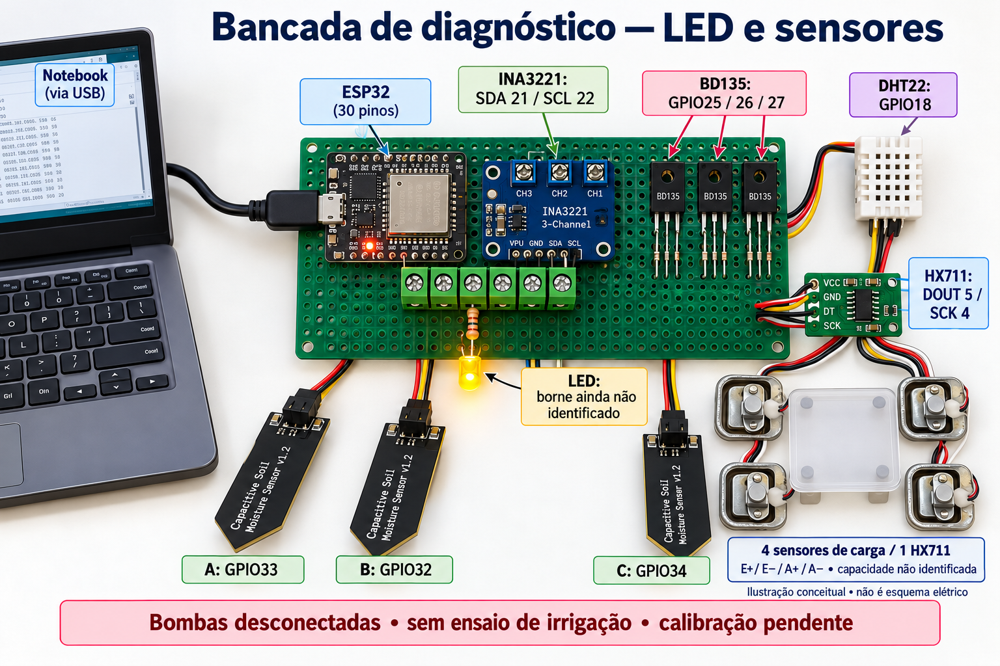

# TCC de irrigação inteligente

Execução prática de um protótipo de baixo custo com ESP32, sensores, controle de bomba e aprendizado de máquina. Entrega em **01/12/2026**. Redação acadêmica fora do escopo.

Ilustração conceitual da bancada atual, não esquema elétrico validado. [Fluxo de diagnóstico com LED](.archify/workflow-bancada-led-20261101-120000/bancada-led.html). Piloto físico com três vasos em andamento desde 16/11/2026 (ver estado abaixo).

[Diagrama interativo do ensaio contínuo](.archify/workflow-ensaio-continuo-20261012-210000/ensaio-continuo.html).

Pastas anteriores em `.archify/` são versões históricas; o link acima identifica o fluxo atual.

## Documentação

- [MVP](docs/mvp.md): definição, funcionamento e critérios de demonstração.
- [Materiais](docs/materiais-tcc.md): quantidades, funções e reaproveitamento.
- [Ligações do protótipo](docs/ligacoes-prototipo.md): sinais, identificação das peças e sequência de montagem; GPIOs identificados, conectores de saída e potência pendentes.
- [Tarefas](docs/tasks-tcc.md): checklist até a entrega prática.
- [Ambiente local](docs/ambiente-local.md): execução, acesso e testes.
- [Protocolo de testes](docs/protocolo-testes.md): tratamentos, medição compartilhada, métricas e calendário.
- [Evidências](docs/evidencias/): fotos da montagem, prints do Grafana e do painel da bancada e registros de serviços/banco do piloto (18/11).
- `docs/referencias/`: três documentos originais preservados.

## Escopo e estado

Arquitetura prática aprovada: ESP32/C++/ESP-IDF, MQTT/Mosquitto, Python/FastAPI, PostgreSQL, Grafana, pesagem com quatro sensores de carga de três fios e um HX711, medição de energia com INA3221 e acionamento das três bombas submersas pelos bornes da bancada. Treinamento separado da inferência; decisão determinística e proteções locais no ESP32.

Software verificado com dados simulados em 12/10/2026: ingestão, controle T1/T2/T3, confirmação de ciclos, contingência, treinamento/inferência, painéis e restauração de backup. Firmware ESP-IDF com núcleo de segurança e drivers de sensores (05/11), gravado na placa e publicando pelo Wi-Fi no broker do notebook (05/11); pesagem reprovada no critério de deriva; atuação das bombas bloqueada até validação do circuito. O estado dos serviços deve ser consultado com `docker compose ps`.

Decisão aprovada: **opção A — 30 dias contínuos, um ESP32 e três vasos**, um por T1/T2/T3, com bombas sequenciais e medidores compartilhados. Orçamento fixo, sem ampliação de materiais ou troca de plantas na quinzena. Resultados descritivos com n=1 por tratamento; os períodos de 15 dias não são réplicas. Backend, simulador e núcleo do firmware foram adaptados para três unidades; operação física depende dos drivers e calibração. Configuração de referência: `config/experiment.json`.

Bancada identificada em 01/11/2026: ESP32 de 30 pinos, DHT22 configurado, HX711, INA3221 e três BD135 NPN. Sensores A/B/C correspondem a GPIO33/32/34. Os três bornes foram identificados com LED/resistor: original GPIO26, segundo testado GPIO25 e último GPIO27. A imagem conceitual foi produzida antes dessa identificação; o mapa atualizado está no guia. Ver [ligações e diagnóstico](docs/ligacoes-prototipo.md).

**Estado em 18/11/2026.** Bancada montada e alimentada por fonte externa; bombas submersas no reservatório, vazão medida em copo (bombas 1 e 2: 50 mL em 2 s; bomba 3: 50 mL em 2,5 s). Solo calibrado com pontos seco e saturado por vaso (`soil-20261116-dry-sat`; ponto seco do pot-02 sob suspeita). Manjericão semeado (6 sementes por vaso) em 16/11. Firmware `physical-irrigation-1` com irrigação automática habilitada e backend com controle físico ligado (`PHYSICAL_CONTROL_ENABLED`). Reservatório contabilizado por reposição registrada menos doses e pulsos manuais, não pesado (pesagem segue reprovada por deriva). Piloto iniciado em 16/11 às 20:40 (23:40 UTC): T1 por horário, T2 por histerese, T3 pela regra do T2 até haver modelo. Até 17/11 nenhuma rega, pois os vasos continuam saturados (índice 100). Detalhes em [ligações do protótipo](docs/ligacoes-prototipo.md).

Próximos passos: com ≥ 48 h de ciclos, treinar e congelar o modelo do T3, fixar T1 e os limites pelo consumo do piloto e iniciar a comparação até 01/12 (menos de 30 dias, por decisão de 04/11; ver [protocolo](docs/protocolo-testes.md)). Metas de economia >20%, MAE <3 pontos e conformidade ≥95% são expectativas, não resultados. Ainda não há resultados físicos.

## Estrutura

`firmware/`: ESP32; `backend/`: ingestão e serviços; `infra/`: configurações; `tests/`: testes; `tools/`: scripts; `data/`: dados; `models/`: modelos; `docs/`: documentação.
